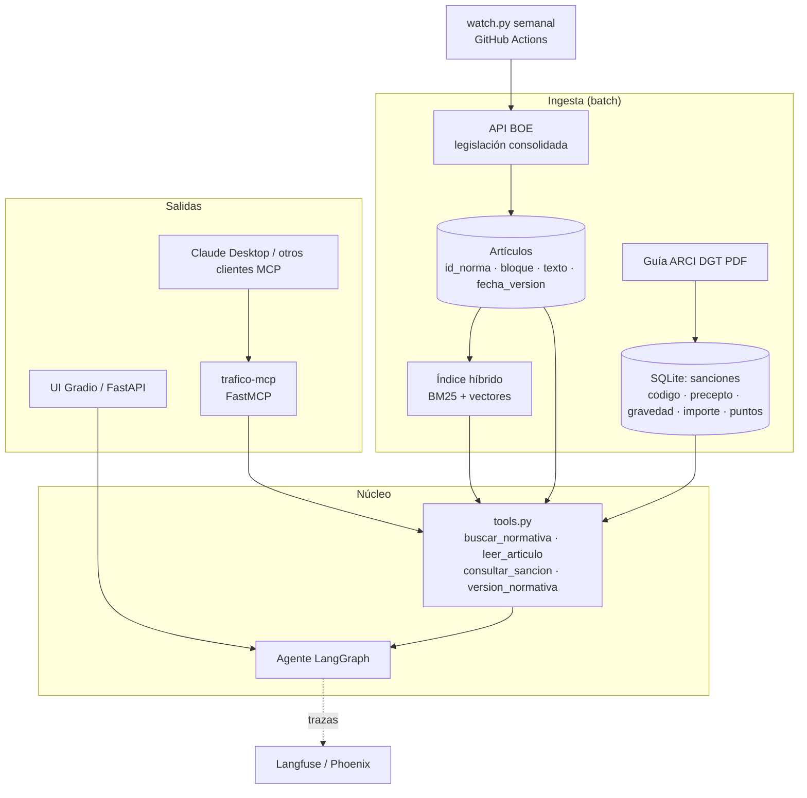
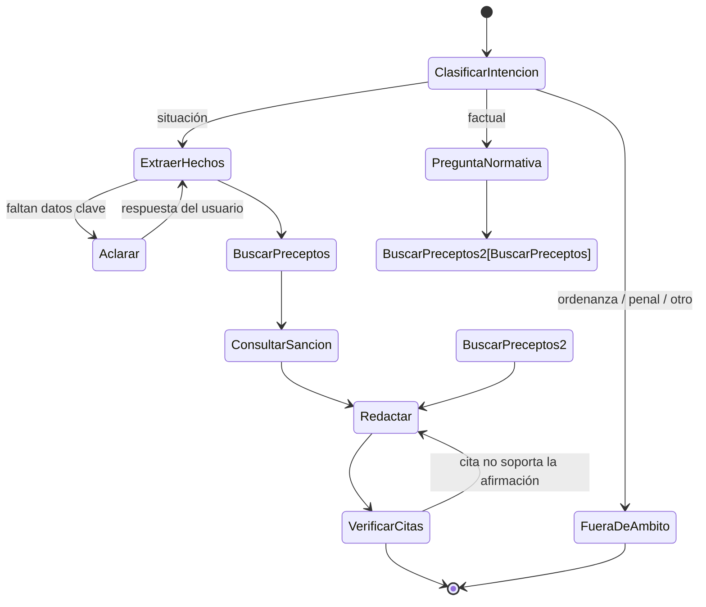

# trafico-agent: arquitectura

## 1. Vista general



## 2. Grafo del agente ("¿es multa?")



- **ExtraerHechos** devuelve un objeto tipado: tipo de vía, velocidad y límite, vehículo, conducta, alcohol o drogas… Si falta algún campo **clave** para esa conducta, se pasa a **Aclarar**.
- **ConsultarSancion** es **SQL determinista** sobre la tabla ARCI. El LLM nunca produce importes ni puntos.
- **VerificarCitas** comprueba que cada frase con una afirmación normativa tiene una cita cuyo texto la respalda. Se hace con un LLM que actúa como juez más la coincidencia de números y palabras clave. Como máximo se reintenta una vez.

## 3. Modelo de datos

```text
articulos
  id_norma (BOE-A-2003-23514) · id_bloque · titulo · texto
  fecha_version · url

sanciones  (desde ARCI)
  codigo · norma · articulo · apartado · opcion · hecho_denunciado
  gravedad (leve|grave|muy_grave) · importe_eur · puntos · observaciones

versiones
  id_norma · fecha_actualizacion · hash_texto · detectado_en
```

## 4. Recuperación

1. Consulta → **BM25** (top 30) + **vectores** con bge-m3 (top 30).
2. Fusión de ambos rankings (RRF) → **reranker** (bge-reranker-v2-m3) → top 5.
3. Fragmentos = **un artículo por fragmento** (o un apartado si el artículo es largo), con el título del capítulo como contexto.
4. Metadatos para filtrar: norma y vigencia.

Se evalúan cuatro configuraciones (BM25, vectores, híbrida y con reranker) con recall@5 y MRR sobre las preguntas *gold*.

## 5. Servidor MCP

| Herramienta | Firma | Devuelve |
|---|---|---|
| `buscar_normativa` | `(consulta: str, k: int = 5)` | Artículos con id, título, fragmento y url |
| `leer_articulo` | `(id_norma: str, articulo: str)` | Texto completo más la fecha de la versión |
| `consultar_sancion` | `(norma: str, articulo: str, apartado?: str)` o `(texto_hecho: str)` | Filas ARCI |
| `version_normativa` | `()` | Fecha consolidada de cada norma del corpus |

Cada respuesta incluye un campo `aviso` con el texto legal.

## 6. Decisiones clave

| Decisión | Motivo |
|---|---|
| Importes y puntos por **SQL** y no por LLM | Son datos exactos y evaluables; se eliminan alucinaciones numéricas |
| Fragmento = artículo | La unidad de cita natural del derecho; recuperación y cita coinciden |
| Recuperación híbrida + reranker | El vocabulario legal ("vía interurbana", "arcén") favorece a BM25; las paráfrasis del usuario favorecen a los vectores |
| LangGraph (grafo explícito) | Flujo auditable y con reintentos; más fácil de evaluar que un agente ReAct libre |
| Mismas herramientas para el agente y para el MCP | Una sola implementación y dos interfaces |
| Langfuse self-hosted | Gratis y estándar; permite ver el coste y la latencia por nodo |

## 7. Tests y evaluación en CI

- **Unitarios:** parser de la ARCI (filas críticas fijas), `consultar_sancion` y el troceado por artículo.
- **Recuperación:** recall@5 sobre las 60 preguntas factuales. La CI falla si baja.
- **Agente:** 20 situaciones de humo con un LLM simulado para comprobar el flujo; la evaluación completa se lanza a mano (necesita LLM).
- **MCP:** test del protocolo con el cliente de pruebas del SDK.

## 8. Despliegue

| Pieza | Dónde | Coste |
|---|---|---|
| Índice y SQLite | Se generan en CI y se publican como artefacto o release | 0 € |
| Demo | HF Spaces (CPU) + API con límite, o un modelo pequeño | 0 € o unos pocos € |
| MCP | PyPI o GitHub (`uvx`) | 0 € |
| Detección de cambios | GitHub Actions, cada semana | 0 € |
