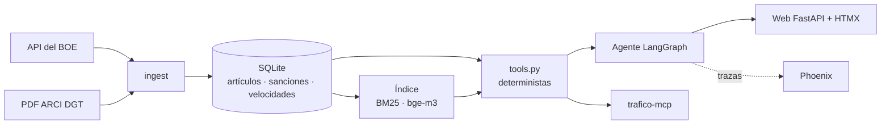

# trafico-agent · ¿Es multa?

[](https://github.com/inigo99/trafico-agent/actions/workflows/ci.yml)
[](https://github.com/inigo99/trafico-agent/actions/workflows/boe-semanal.yml)

Asistente sobre la normativa estatal de tráfico en España que **cita el artículo exacto del BOE** y, ante una situación concreta («iba sin cinturón, ¿es multa?»), devuelve la infracción, su gravedad, el importe, el pronto pago y los puntos de la guía de infracciones de la DGT.

**Demo:** https://trafico-agent.onrender.com (plan gratis: la primera visita tras un rato sin uso tarda en despertar).

> Información orientativa basada en la normativa estatal publicada en el BOE y en la guía de infracciones de la DGT. No es asesoramiento jurídico.

## Qué hace

- **Preguntas con cita:** cada afirmación normativa lleva el artículo y su enlace al BOE; sin cita, no hay respuesta.
- **«¿Es multa?»:** un agente en LangGraph analiza la situación, busca los preceptos y elige la fila de la guía ARCI. **Importes y puntos nunca salen del LLM**: vienen de SQL (tabla ARCI y tramos del Anexo IV de la LSV).
- **Pregunta en vez de suponer:** si falta un dato clave (velocidad, límite, tasa, tipo de conductor, vehículo), lo pide.
- **Reconoce lo que no cubre:** ordenanzas municipales (zona azul, ORA, grúa…), posibles delitos (avisa del Código Penal), competencia de Navarra, Cataluña, País Vasco y policías locales, y temas fuera de ámbito (seguros, ITV, recursos).
- **Servidor MCP** `trafico-mcp` con 6 herramientas deterministas para Claude Desktop u otro cliente.
- **Aviso semanal** de cambios en el BOE (GitHub Actions abre un issue con los artículos modificados).

Corpus: Ley de Tráfico (RDL 6/2015, `BOE-A-2015-11722`), Reglamento General de Circulación (RD 1428/2003, `BOE-A-2003-23514`) y la guía codificada de infracciones (ARCI) de la DGT, 552 filas.

## Arquitectura



```
analizar ─┬─ fuera de ámbito / ordenanza ─────────► rechazar
          ├─ faltan datos clave ──────────────────► aclarar
          └─ buscar ─► sanción ─► redactar ───────► respuesta + avisos + fuentes
```

El LLM solo interviene en tres puntos: analizar la intención, **elegir** una fila ARCI entre candidatas (con la salida limitada por esquema a esos códigos) y redactar. Lo demás son reglas y SQL: cifras y datos del usuario, tramos de velocidad y alcohol, importes y puntos, avisos de delito, competencia y ordenanza. En velocidad y alcohol la respuesta es una plantilla: el LLM no redacta.

## Evaluación

Conjunto propio de **150 preguntas** (`eval/questions.yaml`): 60 factuales, 60 situaciones «¿es multa?» y 30 trampas. Cada caso tiene su gold (artículo y, en las situaciones, la fila ARCI), validado por tests contra los datos; 30 revisados a mano (28/30 correctos, los 2 corregidos).

### Recuperación (135 preguntas con cita, CPU)

| Configuración | recall@5 | MRR | Tiempo por consulta |
|---|---|---|---|
| BM25 | 0,568 | 0,431 | < 1 ms |
| **Vectores bge-m3** (por defecto) | **0,765** | **0,614** | ~0,3 s |
| Híbrida RRF 1:1 | 0,732 | 0,563 | ~0,3 s |
| Híbrida + reranker bge-reranker-v2-m3 | 0,794 | 0,642 | ~32 s |

El reranker es el mejor por poco, pero inviable en CPU; la fusión RRF con pesos iguales empeora a los vectores.

### Agente: 60 situaciones

| Modelo | Comportamiento | Sanción exacta | Cita correcta | s/pregunta |
|---|---|---|---|---|
| Claude Haiku¹ | 95 % | **86 %** | **84 %** | — |
| qwen2.5:7b (Ollama, local) | 95 % | 77 % | 71 % | 6 |
| qwen2.5:3b (Ollama, local) | 93 % | 66 % | 70 % | 3 |
| qwen2.5:1.5b (Ollama, local) | 90 % | 62 % | 48 % | 3 |
| gpt-oss-120b (Groq) + BM25² | 100 % | 67 % | 89 % | 20 |

«Sanción exacta» exige gravedad, importe, pronto pago y puntos idénticos al gold. La fila del 7b es la del test con las correcciones de la revisión manual (23-10-2026); las demás se midieron antes de corregir una situación (S34), así que pueden variar en una pregunta de 60.
¹ Sin clave de API: las llamadas se contestaron con Haiku desde un chat con el proveedor `cola` (`llm.py`), sin JSON forzado por esquema. Respuestas versionadas en `eval/cola/`.
² Configuración de la demo publicada, medida con solo 10 situaciones.

**Trampas** (30; qwen2.5:3b): comportamiento correcto en 30 de 30 (100 %). Ojo, la cifra es optimista: las reglas de ordenanza, delito y competencia se escribieron mirando estas trampas. Donde falla de verdad es al corregir premisas falsas: el modelo no corrige el dato.

### Lo que más pesó

- **Un bug de recuperación de candidatas** (un tope que dejaba fuera todas las filas de los artículos) valía más que cualquier ajuste de prompt: la fila correcta pasó de estar entre las opciones en 30/54 casos a 43/54.
- **Sacar decisiones del LLM:** cifras, tema y vehículo por reglas; elección restringida por enum; frases con importes o gravedad borradas del texto generado. Con eso qwen2.5:1.5b pasó del 9 % al 62 % de sanciones exactas.
- El límite que queda es **elegir entre filas ARCI casi idénticas**: Haiku acierta 37 códigos exactos y el 7b, 28.

## Uso

Requisitos: Python 3.12 y [uv](https://docs.astral.sh/uv/).

```bash
uv sync --extra ml                                  # + bge-m3 (opcional: sin él, BM25)
uv run python -m trafico_agent.ingest.arci          # PDF ARCI -> sanciones
uv run python -m trafico_agent.ingest.boe           # API del BOE -> artículos (red)
uv run python -m trafico_agent.ingest.postproceso   # cruce y fragmentos
uv run --extra ml python -m trafico_agent.index     # vectores bge-m3
```

**Agente en local** (Ollama con `qwen2.5:7b` o `TRAFICO_MODELO`):

```bash
uv run python -m trafico_agent.agent "Iba a 140 km/h por una autovía limitada a 120"
uv run --extra ml --extra demo uvicorn trafico_agent.web:app        # web en localhost:8000
```

**Servidor MCP** en Claude Desktop (`claude_desktop_config.json`):

```json
"trafico": {
  "command": "uv",
  "args": ["--directory", "/ruta/trafico-agent", "run", "--extra", "ml", "trafico-mcp"],
  "env": {"TRAFICO_DB": "/ruta/trafico-agent/data/trafico.db"}
}
```

Herramientas: `buscar_normativa`, `leer_articulo`, `consultar_sancion`, `sanciones_parecidas`, `consultar_velocidad` y `version_normativa`.

**Evaluación:**

```bash
uv run python eval/run_retrieval.py                      # recuperación
uv run python eval/run_agent.py --tipo situacion         # agente (situacion | factual | trampa)
uv run python eval/run_agent.py --modelo qwen2.5:3b      # otro modelo de Ollama
TRAFICO_API_KEY=... uv run python eval/run_agent.py --modelo api:openai/gpt-oss-120b
```

**Trazas** (Phoenix, local): `uv run --extra obs phoenix serve` y `TRAFICO_TRAZAS=1` al ejecutar. Muestra un span por nodo del grafo y otro por llamada al LLM, con tokens y latencia.

**Tests:** `uv run pytest` (226 tests, sin red; la CI genera la base y la guarda en caché).

## Despliegue de la demo

`render.yaml` (Render, plan gratis, 512 MB): la base se genera en el build y la web usa BM25 (sin torch ni bge-m3) y `gpt-oss-120b` por la API de Groq (`TRAFICO_LLM=api`, `TRAFICO_API_KEY`). El proveedor `api` vale para cualquier API compatible con OpenAI (`TRAFICO_API_URL`).

## Limitaciones

- Solo normativa estatal: no hay ordenanzas municipales ni normativa autonómica propia.
- La guía ARCI es de 2025 y el RGC tiene artículos de 2026: 11 filas citan apartados que ya no existen. El agente avisa en esos casos.
- Con modelos pequeños el texto redactado puede ser pobre, aunque la sanción y la cita salgan de los datos. Comprueba siempre el artículo enlazado.
- Las cifras de trampas son optimistas (ver arriba) y la demo pública usa BM25, que recupera peor que bge-m3.

## Estructura

```
src/trafico_agent/
  ingest/        arci.py (PDF → SQLite) · boe.py (API BOE) · postproceso.py (cruce y fragmentos)
  index.py       BM25, vectores, híbrida y reranker
  tools.py       herramientas deterministas (agente y MCP)
  agent.py       grafo LangGraph
  llm.py         proveedores: Ollama, API compatible con OpenAI, cola (respuestas a mano)
  mcp_server.py  trafico-mcp
  web.py         demo FastAPI + HTMX
  trazas.py      Phoenix / OpenTelemetry
  watch.py       cambios en el BOE
eval/            questions.yaml, run_retrieval.py, run_agent.py, run_candidatos.py, results/
notas/           decisiones y resultados de cada semana
```

## Fuentes y licencia

Textos legales del BOE, obtenidos de su API de datos abiertos de legislación consolidada (reutilizables citando la fuente), y guía ARCI publicada por la DGT. Código bajo licencia MIT (ver `LICENSE`).
